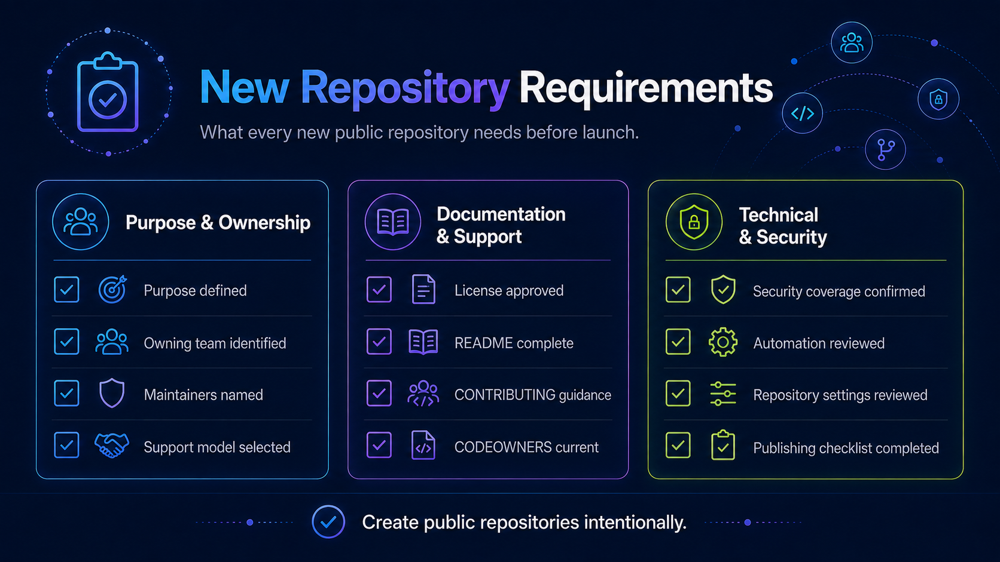

# New Public Repository Requirements

New repositories intended for public release should be designed for public operation from the beginning.

## Before creating the repository

Have the following information ready:

### Project purpose

- Project name.
- Problem being solved.
- Intended audience.
- Relationship to Dynatrace products or ecosystems.
- Why a new repository is required.

### Ownership

Identify:

- Owning team.
- Primary maintainer.
- Backup maintainer.

### Support model

Choose:

- Officially supported.
- Community-supported.
- Experimental.

### Repository organization

Determine the appropriate Dynatrace GitHub organization.

Repository location should reflect governance and purpose, not simply the preference of the creating team.

### License

Select an approved open source license.

Do this before accepting external contributions.

## Required repository files

Before publication, repositories should include:

- `README.md`
- `LICENSE`
- `SECURITY.md`
- `CODEOWNERS`

Where external contributions are accepted:

- `CONTRIBUTING.md`

Where broader community participation is expected:

- `CODE_OF_CONDUCT.md`

## Repository configuration

Configure where appropriate:

- Repository description.
- Topics.
- Branch protections or rulesets.
- Required reviews.
- Dependency update automation.
- Secret scanning.
- Security scanning.
- CI.
- Release automation.

## Naming

Repository names should:

- Be understandable outside Dynatrace.
- Avoid internal-only acronyms where possible.
- Avoid misleading product naming.
- Avoid implying official product support unless appropriate.
- Be durable enough to survive organizational changes.

## Avoid repository proliferation

Before creating a new repository, ask whether the content belongs in:

- An existing repository.
- An upstream project.
- An examples repository.
- Existing documentation.
- A monorepo.

Creating a repository creates ongoing governance and maintenance cost.

## Repository Name Validation

Before creating a new repository, verify that the proposed
repository name has not previously been used by a repository
that was transferred or renamed.

GitHub automatically maintains redirects for transferred and
renamed repositories. Reusing an original repository name
can override the redirect and break existing links.

### Requirements

- Check the reserved repository names registry before approving
  a new repository.
- Do not reuse reserved repository names without approval.
- Escalate potential naming conflicts to OSPO and GitHub Tooling.
- Document any approved exceptions.

For the current list of reserved names and additional guidance,
see [Repository Transfers](repository-transfers.md#reserved-repository-names).

## Next step

Complete the requirements in:

[Publishing Checklist](publishing-checklist.md)
